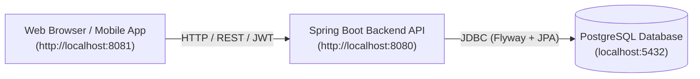
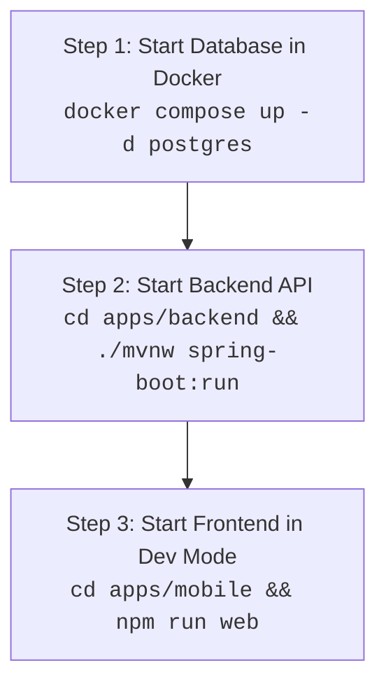

# TutorZen — Service Execution & Developer Guide

This document is the definitive guide on how to run, configure, and develop the **Frontend**, **Backend**, and **Database** of TutorZen.

---

## 1. Architecture & Port Overview

| Service | Technology | Internal Port | Host Port | URL / Connection |
| :--- | :--- | :--- | :--- | :--- |
| **Database** | PostgreSQL 16 (Alpine) | `5432` | `5432` | `jdbc:postgresql://localhost:5432/tutorzen_dev` |
| **Backend API** | Spring Boot 3.4.3 (Java 21) | `8080` | `8080` | `http://localhost:8080` |
| **Frontend UI** | React Native + Expo Web (Nginx) | `8081` | `8081` | `http://localhost:8081` |



---

## 2. Quick Start: Run Everything at Once (Docker Compose)

The easiest way to start all services simultaneously with zero manual setup.

### Prerequisites
- [Docker Desktop](https://www.docker.com/products/docker-desktop/) installed and running.

### Start All Services

From the repository root, run:

```bash
# Using the automated orchestrator script:
./scripts/run-all.sh

# Or using standard npm command:
npm run services:up

# Or using Docker Compose directly:
docker compose up --build -d
```

### What Happens Automatically:
1. Starts the PostgreSQL container and waits until the database healthcheck reports **healthy**.
2. Compiles and starts the Spring Boot backend, automatically applying Flyway database migrations (`V1` through `V4`).
3. Builds the React Native Web assets and serves them via high-performance Nginx.
4. Outputs direct links to the running applications.

### Open the Application
- **Frontend App:** [http://localhost:8081](http://localhost:8081)
- **Backend API:** [http://localhost:8080](http://localhost:8080)
- **Database:** `localhost:5432` (Database: `tutorzen_dev`, User: `tutorzen`, Password: `tutorzen_secret`)

### Management & Teardown Commands

```bash
# Check running status of all containers
npm run services:status
# or: ./scripts/run-all.sh --status

# Stream real-time logs from all services
npm run services:logs
# or: ./scripts/run-all.sh --logs

# Stream logs for a specific service (e.g. backend)
docker compose logs -f backend

# Stop and remove all containers
npm run services:down
# or: ./scripts/run-all.sh --down
```

---

## 3. Running Services Individually (Local Development)

If you are developing features and want **live code reloading**, fast compile times, and debugger support, run the services on your host machine as described below.



---

### Step 1: Start the PostgreSQL Database

Keep PostgreSQL running in a lightweight Docker container:

```bash
# Start only the database container in the background
docker compose up -d postgres
```

- **Host:** `localhost`
- **Port:** `5432`
- **Database:** `tutorzen_dev`
- **Username:** `tutorzen`
- **Password:** `tutorzen_secret`

To verify database readiness:
```bash
docker exec -it tutorzen-postgres pg_isready -U tutorzen -d tutorzen_dev
```

---

### Step 2: Start the Spring Boot Backend

The backend is built with Spring Boot 3.4.3 and requires **Java 21**.

```bash
cd apps/backend

# Run the Spring Boot application (Flyway migrations run automatically on startup)
./mvnw spring-boot:run
```

#### Verification & Health:
Once started, the backend listens on port `8080`. Test with:

```bash
# Test sign-in endpoint (returns 200 with JWT tokens)
curl -s -X POST http://localhost:8080/api/v1/auth/sign-in \
  -H "Content-Type: application/json" \
  -d '{"email":"teacher@demo.com","password":"Teacher@123"}'
```

#### Run Backend Tests:
```bash
cd apps/backend && ./mvnw test
```

---

### Step 3: Start the Mobile / Web Frontend

The frontend is built with React Native, TypeScript, and Expo.

#### First-time setup:
Ensure design token dependencies and packages are installed:
```bash
# From repository root
npm install
npm run build --workspaces --if-present
```

#### Start in Web Browser (Hot Reloading):
```bash
cd apps/mobile

# Start Expo Web dev server on port 8081
npm run web
```
The browser will automatically open [http://localhost:8081](http://localhost:8081).

#### Run Frontend Tests & Typecheck:
```bash
# Typecheck mobile app
cd apps/mobile && npm run typecheck

# Run mobile unit tests
cd apps/mobile && npm test
```

---

## 4. Pre-seeded Demo Accounts

TutorZen comes pre-populated with demo credentials (created via Flyway migration `V2__identity_schema.sql`):

| Role | Email | Password | Permissions & Available Screens |
| :--- | :--- | :--- | :--- |
| **Teacher** | `teacher@demo.com` | `Teacher@123` | Class schedule, mark attendance, bulk mark, upload learning notes & materials |
| **Student** | `student@demo.com` | `Student@123` | Student home, mark attendance by PIN/QR, view attendance summary |
| **Admin** | `admin@demo.com` | `Admin@123` | Full coaching administration access |

> [!TIP]
> On the mobile login screen ([http://localhost:8081](http://localhost:8081)), convenient **"1-Tap Demo Login"** buttons are available to sign in immediately without typing passwords.

---

## 5. Environment Variables & Configuration

### Backend (`apps/backend/src/main/resources/application.yml`)

| Variable | Default Value | Description |
| :--- | :--- | :--- |
| `SPRING_DATASOURCE_URL` | `jdbc:postgresql://localhost:5432/tutorzen_dev` | Database JDBC URL (`postgres` in Docker) |
| `SPRING_DATASOURCE_USERNAME` | `tutorzen` | Database username |
| `SPRING_DATASOURCE_PASSWORD` | `tutorzen_secret` | Database password |
| `JWT_SECRET` | `dev-secret-key-must-be-replaced-...` | 256-bit secret key for HMAC-SHA signing |
| `JWT_EXPIRY_SECONDS` | `900` (15 minutes) | Access token lifespan |
| `JWT_REFRESH_EXPIRY_SECONDS` | `604800` (7 days) | Rotating refresh token lifespan |
| `SERVER_PORT` | `8080` | Spring HTTP server port |

### Frontend (`apps/mobile/src/services/apiClient.ts`)

The frontend automatically resolves the backend URL based on platform:
- **Web (`localhost`):** `http://localhost:8080`
- **Android Emulator:** `http://10.0.2.2:8080`
- **Physical Device:** Set to your host machine's local IP (e.g. `http://192.168.1.X:8080`).

---

## 6. Standalone Mobile App Builds (APK & iOS)

TutorZen includes automated build scripts to generate standalone native application packages without installing heavy local IDEs:

```bash
# Build Android APK via Docker (outputs to dist/tutorzen.apk):
npm run build:apk:docker

# Build Android APK via EAS Cloud:
npm run build:apk:eas

# Build iOS Simulator Package (no Apple Developer account needed):
npm run build:ios:sim

# Build iOS Device Package (.ipa):
npm run build:ios:device
```

---

## 7. Troubleshooting & FAQ

### Port 5432 or 8080 is already in use
If an existing PostgreSQL or backend process is running locally:
```bash
# Check what is using port 5432
lsof -i :5432
# Check what is using port 8080
lsof -i :8080
# Check what is using port 8081
lsof -i :8081
```
Kill the conflicting process or stop the local service before running Docker.

### Reset the Database to Clean Seed State
To completely wipe the database volume and re-run all Flyway migrations:
```bash
docker compose down -v
docker compose up -d postgres
```

### CORS Errors in Browser
The backend Spring Security configuration in [`SecurityConfig.java`](file:///Users/avinash/avinash/tutorzen/apps/backend/src/main/java/com/tutorzen/common/security/SecurityConfig.java) permits `http://localhost:*`, `http://127.0.0.1:*`, and local network IP ranges. Ensure the backend is running on port 8080 and accepting preflight `OPTIONS` requests.

### Checking Docker Container Health
```bash
docker ps --format "table {{.Names}}\t{{.Status}}\t{{.Ports}}"
```
All containers (`tutorzen-postgres`, `tutorzen-backend`, `tutorzen-frontend`) should show status `Up`.

