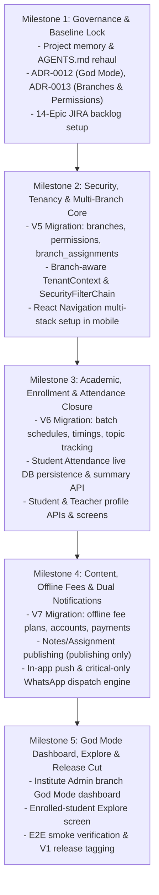

# TutorZen Complete V1 Rehaul — Baseline Audit & Gap Report

> **Document:** `docs/audits/V1_REHAUL_AUDIT_REPORT.md`  
> **Status:** Authoritative Baseline Audit (Phase 0)  
> **Repository:** https://github.com/kavinash09/TutorZen  
> **Execution Date:** October 22, 2026  
> **Backend Baseline:** 46/46 unit & integration tests passing (`./mvnw test`)  
> **Mobile Baseline:** 20/20 unit tests passing (`npm test`), 0 TypeScript compile errors (`npx tsc --noEmit`)  
> **Design Tokens Baseline:** 12/12 unit assertions passing (`npx tsx --test`)  

---

## 1. Executive Summary & Audit Mandate

This audit establishes the baseline reality of the TutorZen repository prior to executing the **TutorZen Complete V1 Rehaul**.

TutorZen is an AI-assisted multi-tenant coaching management ERP. It operates as a clean **modular monolith** with Spring Boot 3.4.3 (Java 21) on the backend, React Native 0.76 / Expo SDK 52 (TypeScript 5.8) on mobile/web, PostgreSQL 16 with Flyway migrations, and a shared `@tutorzen/design-tokens` package.

### Key Audit Findings
1. **Strong Foundational Baseline:** Security filter chains, stateless JWT authentication with rotating refresh tokens, tenant isolation derived strictly from verified JWT claims, Strategy Pattern attendance marking, learning materials metadata upload, and turnkey Docker Compose runners are fully operational and verified.
2. **Multi-Institute & Multi-Branch Architecture Required:** The existing schema operates at a single-tier `tenants` level. The V1 Rehaul requires expanding this into a hierarchical **Institute $\longrightarrow$ Multiple Branches** model with branch-level data isolation, multi-branch teacher/staff assignments, and multi-branch student enrollments.
3. **Permission-Based RBAC Over Flat Enums:** The current system uses a flat enum (`TEACHER`, `STUDENT`, `ADMIN`). The V1 Rehaul requires introducing explicit, delegable permissions (e.g. `INSTITUTE_MANAGE`, `BRANCH_MANAGE`, `FEES_MANAGE`, `DASHBOARD_VIEW`, `DASHBOARD_FEES_VIEW`) for Platform Admins, Institute Admins, and Moderators.
4. **Scope Boundaries Clarified:**
   - **Fees:** Explicitly **Offline Fees Only** (Cash, UPI, Cheque, Bank Transfer) with receipt generation, partial payments, and auditable reversals. **No online payment gateway in V1.**
   - **Notes & Assignments:** Explicitly **Publishing Only** (Drafts, Published, Batch targeting, Material preview, 1-level nested discussion comments). **Assignment submission, grading, and feedback are explicitly OUT OF SCOPE for V1.**
   - **Notifications:** Dual-channel (In-App/Push by default; WhatsApp strictly for **critical notifications** such as fee reminders and urgent schedule/topic changes).
   - **Explore:** Enrolled-student explore within permitted institute scope only. **No anonymous discovery or public marketplace.**

---

## 2. Current Architecture & Module Map

```text
TutorZen Repository Structure
├── apps/
│   ├── backend/                        # Spring Boot 3.4.3, Java 21, Maven
│   │   └── src/main/java/com/tutorzen/
│   │       ├── identity/               # JWT issuance, rotation, credentials, users
│   │       ├── tenancy/ & common/tenancy/ # TenantContext thread-local, TenantFilter
│   │       ├── academics/              # Subjects, Batches, Students, ClassSessions
│   │       ├── attendance/             # Strategy Pattern (Bulk, QR, PIN), Roster
│   │       ├── attendancesync/         # Offline attendance sync service (in-memory)
│   │       ├── materials/              # Learning materials metadata repository
│   │       └── common/security/        # Spring Security SecurityFilterChain
│   └── mobile/                         # React Native 0.76, Expo SDK 52, TypeScript
│       └── src/
│           ├── context/AuthContext.tsx # JWT token handling, 1-tap demo logins
│           ├── services/apiClient.ts   # Axios/Fetch client with transparent 401 refresh
│           ├── screens/                # TeacherHomeScreen, MarkAttendanceScreen,
│           │                           # StudentHomeScreen, StudentAttendanceEntryScreen,
│           │                           # StudentAttendanceSummaryScreen, UploadNotesScreen
│           ├── utils/rosterUtils.ts    # Immutable roster state manipulation
│           └── theme/ & components/    # Claymorphic UI tactile components
├── packages/
│   └── design-tokens/                  # @tutorzen/design-tokens (EB Garamond, Barlow, Clay)
├── infrastructure/
│   └── docker/                         # docker-compose.yml (PostgreSQL 16)
├── docs/                               # Architecture, Product V1 Scope, UX, Development
└── .ai/                                # Project memory (STATE, CONTEXT, DECISIONS, EVENT_LOG)
```

---

## 3. Current Feature & Screen Inventory

| Screen / Flow | Platform | Backed by API? | Current Reality / Status |
| :--- | :--- | :--- | :--- |
| `AuthScreen.tsx` | Mobile / Web | Yes (`POST /api/v1/auth/sign-in`) | `EXISTS_AND_VERIFIED`: Claymorphic login form, 1-tap demo credentials for Teacher and Student, transparent refresh. |
| `TeacherHomeScreen.tsx` | Mobile / Web | Yes (`GET /api/v1/teacher/sessions/today`) | `EXISTS_AND_VERIFIED`: Live online status indicator, today's schedule cards, session metric cards. |
| `MarkAttendanceScreen.tsx`| Mobile / Web | Yes (`POST /roster/submit`) | `EXISTS_AND_VERIFIED`: Strategy selector (Bulk, QR, PIN), live roster toggle state, real-time counters. |
| `UploadNotesScreen.tsx` | Mobile / Web | Yes (`GET/POST /teacher/materials`) | `EXISTS_AND_VERIFIED`: Subject selector, drag-and-drop dropzone, OS file picker, required field highlight validation. |
| `StudentHomeScreen.tsx` | Mobile / Web | Prototype | `PARTIALLY_IMPLEMENTED`: Screen renders active sessions; needs React Navigation integration. |
| `StudentAttendanceEntryScreen.tsx` | Mobile / Web | Prototype (Simulated) | `PARTIALLY_IMPLEMENTED`: 6-digit PIN input; needs live backend API wiring (`POST /students/attendance/submit`). |
| `StudentAttendanceSummaryScreen.tsx` | Mobile / Web | Prototype (Mock 92%) | `PARTIALLY_IMPLEMENTED`: Summary card renders mock 92%; needs live database aggregation endpoint. |
| `HomeScreen.tsx` | Mobile / Web | None | `NEEDS_REFACTOR`: Orphaned starter file; not referenced in active flows. |
| Platform Admin Screen | None | None | `MISSING`: Needs implementation in V1 Rehaul. |
| Institute Admin Dashboard | None | None | `MISSING`: Needs God Mode branch drill-down dashboard. |
| Student Explore Screen | None | None | `MISSING`: Needs authenticated enrolled-student explore screen. |

---

## 4. Data Model & Flyway Migration Inventory

| Migration Version | Description | Key Tables Created | Constraints & Foreign Keys |
| :--- | :--- | :--- | :--- |
| **`V1__init_schema.sql`** | Multi-tenant baseline | `tenants`, `attendance_records` | `tenants.slug` UNIQUE, FK on `attendance_records.tenant_id`, unique index on `(tenant_id, session_id, student_id)`. |
| **`V2__identity_schema.sql`**| Identity & auth | `users`, `user_credentials`, `refresh_tokens` | `(tenant_id, email)` UNIQUE, BCrypt password storage, SHA-256 hashed refresh tokens with cascading deletes. |
| **`V3__academics_schema.sql`**| Academic core | `subjects`, `batches`, `students`, `batch_enrollments`, `class_sessions` | FKs to `tenants`, `subjects`, `batches`, `users`. Session codes and QR payloads tied to expiration timestamps. |
| **`V4__materials_schema.sql`**| Learning materials | `learning_materials` | FKs to `tenants`, `subjects`, `users`. Indexes on `(tenant_id, subject_id)` and `uploaded_by`. |

---

## 5. Role, Permission & Tenant-Boundary Audit

1. **Authentication:**
   - Stateless JWT authentication is active (`com.tutorzen.identity.service.JwtService`).
   - Tokens expire after 15 minutes; refresh tokens expire after 7 days and rotate atomically upon each refresh.
   - 401 unauthenticated JSON handler active (`com.tutorzen.common.security.DelegatingAuthenticationEntryPoint`).
2. **Tenant Isolation:**
   - `TenantFilter` extracts `tenant_id` claim strictly from validated JWT claims.
   - Client-supplied `X-Tenant-ID` HTTP headers are explicitly ignored for authenticated requests.
   - `TenantContext` stores tenant ID in `ThreadLocal` and is cleared in a `finally` block.
3. **Current Role Model Limitation (Needs Refactor):**
   - The role is currently stored as a flat string in `users.role` (`TEACHER`, `STUDENT`, `ADMIN`).
   - The V1 Rehaul requires adding `PLATFORM_ADMIN`, `INSTITUTE_ADMIN`, and `MODERATOR`, plus a fine-grained `permissions` table to support delegated moderator access and independent financial report permissions.

---

## 6. UX & Design-System Audit

- **Shared Tokens Package (`@tutorzen/design-tokens`):**
  - Exports cohesive palette (warm canvas `#FDFBF7`, tactile surface `#F4F6F9`, forest green primary `#1B4332`, warning `#D97706`, error `#DC2626`).
  - Typography correctly specifies `EB Garamond` for prominent headings and `Barlow` for functional UI.
  - 12 unit assertions pass cleanly (`npx tsx --test`).
- **Tactile Claymorphism Implementation:**
  - `TactileButton.tsx` and `TactileCard.tsx` utilize restrained dual shadows (light upper highlight + dark lower elevation) without decorative excess.
- **Mobile Navigation Status (Needs Refactor):**
  - `App.tsx` currently uses manual `useState` screen switching.
  - React Navigation (`@react-navigation/native`, `@react-navigation/native-stack`, `@react-navigation/bottom-tabs`) must be installed to support native transitions, deep linking, and role-based stacks (`AuthStack`, `TeacherTabs`, `StudentTabs`, `AdminTabs`).

---

## 7. Build, Test & Deployment Baseline

| Component | Test / Build Command | Result | Pass Rate | Notes |
| :--- | :--- | :--- | :---: | :--- |
| **Backend Suite** | `cd apps/backend && ./mvnw test` | **BUILD SUCCESS** | **46 / 46 (100%)** | Covers auth, token rotation, tenant context, teacher sessions, materials persistence, attendance strategies. |
| **Mobile Suite** | `cd apps/mobile && npm test` | **PASS** | **20 / 20 (100%)** | Covers roster utilities, count calculations, materials upload validation. |
| **Mobile Typecheck** | `cd apps/mobile && npx tsc --noEmit` | **CLEAN** | **0 Errors** | Strict TypeScript 5.8 compilation. |
| **Design Tokens** | `cd packages/design-tokens && npx tsx --test` | **PASS** | **12 / 12 (100%)** | Palette, typography, spacing, radii, claymorphism tokens. |
| **Docker Compose** | `docker compose up -d` | **HEALTHY** | **3 / 3 Containers** | PostgreSQL (5432), Backend (8080), Web UI (8081). |
| **Android APK Build** | `scripts/build-apk.sh` | **SUCCESS** | **61.14 MB** | Release APK compiled inside Docker without host Android Studio. |

---

## 8. Complete V1 Gap Matrix

Classification Legend:
- `EXISTS_AND_VERIFIED`: Implemented, tested, and verified against real database.
- `PARTIALLY_IMPLEMENTED`: Code exists but requires completion, wiring, or persistence.
- `NEEDS_REFACTOR`: Requires architectural adjustment to meet V1 rehaul invariants.
- `MISSING`: Not yet implemented in the codebase.
- `BLOCKED_BY_DECISION`: Awaiting an architectural decision before implementation.
- `OUT_OF_SCOPE_FOR_V1`: Formally excluded from V1.

| V1 Domain / Capability | Scope Detail | Current Codebase Status | Status Classification |
| :--- | :--- | :--- | :--- |
| **A. Platform Admin & Onboarding** | Institute onboarding, branch creation, invite initial admin, institute lifecycle (`ACTIVE`, `SUSPENDED`, `DEACTIVATED`). | `tenants` table exists. No branch model or platform admin endpoints. | `PARTIALLY_IMPLEMENTED` |
| **B. Institute Admin** | Manage profile, branches, moderators with delegated permissions, staff/teacher lifecycle, God Mode dashboard. | `usr-admin-01` exists. Lacks branch scoping and granular permission delegation. | `NEEDS_REFACTOR` |
| **C. Moderator** | Assigned branch access, explicit permissions only, no implicit institute-wide access. | No moderator model or branch assignment table. | `MISSING` |
| **D. God Mode Dashboard** | Branch-wise metrics (fees, staff, students, sessions, attendance), date filters, branch drill-down. Separate financial permissions. | No dashboard aggregation service or UI. Was deferred by ADR-0005. | `MISSING` (Superseding ADR-0005) |
| **E. Staff & Teacher Management** | Multi-branch assignments, batch assignments, deactivation lifecycle, historical record preservation. | Teacher role exists; single-tenant only. Lacks multi-branch assignments and formal lifecycle. | `PARTIALLY_IMPLEMENTED` |
| **F. Batch & Academic Management** | Batch CRUDL, lifecycle (`DRAFT`, `UPCOMING`, `ACTIVE`, `COMPLETED`), branch link, class timings, topic tracking. | `batches` and `class_sessions` exist. Lacks `branch_id`, timings, topic fields, and lifecycle state. | `PARTIALLY_IMPLEMENTED` |
| **G. Attendance (Teacher & Student)** | Teacher marks roster (Bulk/QR/PIN); student verified check-in; duplicate prevention (409); live stats. | Teacher flow verified. Student submission and summary aggregation in progress. | `PARTIALLY_IMPLEMENTED` |
| **H. Offline Fees Only** | Fee obligations, due dates, offline payment entry (Cash/UPI/Cheque), receipts, partials, auditable reversals, reminders. **NO gateway.** | No fee tables or endpoints in codebase. | `MISSING` |
| **I. Notes & Assignments (Publishing)**| Title, attachments, topic, deadline, target eligible batches, published filter. **NO student submissions or grading.** | `learning_materials` and upload screen verified. Lacks batch targeting and assignment entity. | `PARTIALLY_IMPLEMENTED` |
| **J. Announcements & Notifications** | Announcement CRUDL, branch/batch targeting, In-App/Push alerts. **WhatsApp strictly for critical alerts** (fees, urgent notices). | In-app push and WhatsApp dispatch engines not yet implemented. | `MISSING` |
| **K. Student Enrollment Lifecycle** | Student account separate from enrollment, multi-branch, batch transfers, withdrawals, deactivation, history preservation. | `students` and `batch_enrollments` exist. Multi-branch and enrollment lifecycle states missing. | `PARTIALLY_IMPLEMENTED` |
| **L. Student Experience & Explore** | Student profile, personal attendance, fee balance/receipts, notes board, notice board, **enrolled-student Explore**. | Student screens exist in prototype. Explore screen and fee board missing. | `PARTIALLY_IMPLEMENTED` |
| **M. Cross-Cutting & Security** | JWT auth, tenant + branch isolation, centralized permission checks, audit logging, safe migrations. | JWT and tenant isolation verified. Permissions, branch filtering, and audit log table missing. | `PARTIALLY_IMPLEMENTED` |

---

## 9. Technical Debt & Risk Register

| Risk / Debt Item | Severity | Area | Technical Consequence | Mitigation Strategy |
| :--- | :--- | :--- | :--- | :--- |
| **Multi-Branch Hierarchy Migration** | `HIGH` | Database / Backend | Existing tables (`batches`, `students`) only have `tenant_id`. Introducing `branch_id` could break existing foreign keys or queries. | Forward migration `V5` creates `branches` table, seeds default branch for `tenant-default`, adds nullable `branch_id` foreign keys with fallback to default branch. Zero data loss. |
| **Flat Role Enum to Granular Permissions** | `HIGH` | Security / Backend | Currently `@Secured({"ROLE_TEACHER", ...})` uses flat strings. Moderator role requires dynamic permission evaluation. | Add `permissions` and `user_permissions` tables. Retain primary role archetype on `users` while introducing `@PreAuthorize("hasAuthority('...')")`. |
| **Superseding ADR-0005 (God View)** | `MEDIUM` | Architecture / Docs | ADR-0005 deferred God View UI. The V1 Rehaul explicitly mandates the branch-wise God Mode dashboard. | Append `ADR-0012: Branch-Scoped God Mode Dashboard for Institute Admins` superseding ADR-0005. |
| **Student Attendance Mock Endpoints** | `HIGH` | Backend | `StudentAttendanceController` returns simulated mock data. | Implement `TZ-E09` to wire controller to `AttendanceRecordRepository` with session validation and idempotency. |
| **Mobile Navigation State Switching** | `HIGH` | Mobile | `App.tsx` uses manual `useState` routing. | Implement `TZ-E01` / `TZ-E02` installing React Navigation stacks (`AuthStack`, `TeacherTabs`, `StudentTabs`, `AdminTabs`). |
| **Offline Sync Decoupling** | `MEDIUM` | Backend | `attendancesync` imports domain `AttendanceRecord` directly. | Decouple sync package via public port interface `AttendanceEventPort`. |

---

## 10. Recommended Migration & Implementation Sequence

To execute the rehaul with zero downtime and reviewable increments, the work is organized into 5 sequential delivery milestones:



---

## 11. Audit Checkpoint Conclusion

The baseline is verified, stable, and ready for the V1 Rehaul. 
The immediate next actionable step is to update the repository's governance, project memory, and JIRA backlog to reflect the finalized 14-epic structure (`TZ-E01` to `TZ-E14`), followed by implementing the core multi-branch and permission schema migration (`V5`).

